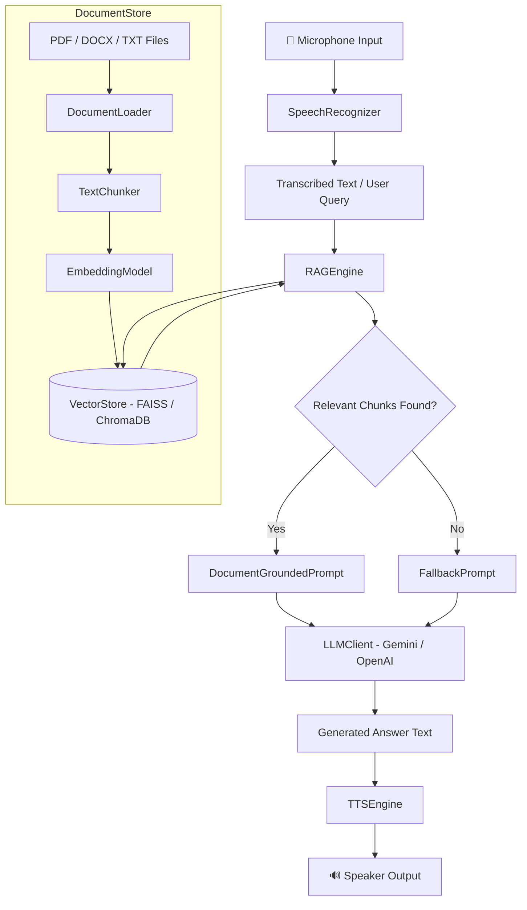
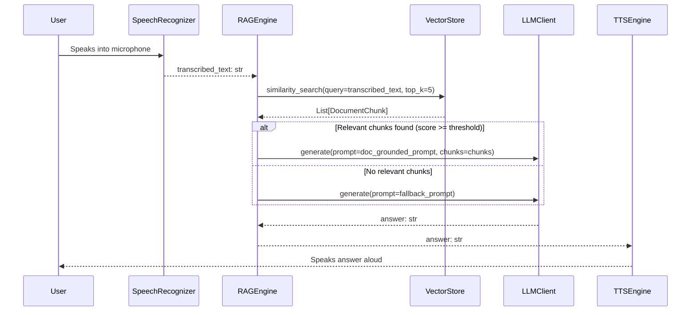
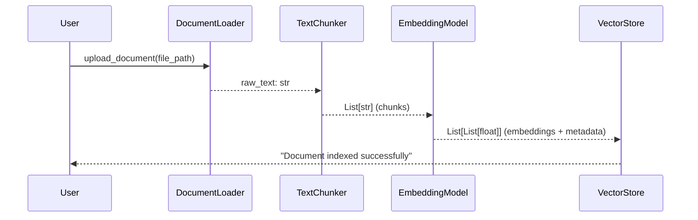

# Design Document: AI Voice Assistant with RAG

## Overview

An AI-powered voice assistant that listens to spoken user queries, searches through uploaded documents (PDF, DOCX, TXT) using Retrieval-Augmented Generation (RAG), and responds with a synthesized voice answer. When the answer is found in the documents, it is grounded in that content; otherwise, the system falls back to a general LLM response via Gemini or OpenAI API.

The system is built entirely in Python and follows a linear pipeline: microphone input → speech-to-text → RAG retrieval → LLM generation → text-to-speech → audio output. The design prioritizes low latency, modularity, and clear separation of concerns across five main components.

The assistant is particularly suited for domain-specific use cases — such as querying banking notes, legal documents, or study material — where document-grounded answers are preferred over general LLM hallucinations.

---

## Architecture



---

## Sequence Diagrams

### Main Query Flow



### Document Ingestion Flow



---

## Components and Interfaces

### Component 1: SpeechRecognizer

**Purpose**: Captures audio from the microphone and converts it to text using a speech-to-text engine (e.g., `speech_recognition` library with Google STT or Whisper).

**Interface**:
```python
class SpeechRecognizer:
    def listen(self, timeout: float = 5.0) -> str:
        """Captures microphone input and returns transcribed text."""
        ...

    def set_energy_threshold(self, threshold: int) -> None:
        """Adjusts microphone sensitivity for ambient noise."""
        ...
```

**Responsibilities**:
- Open microphone stream and listen for speech
- Apply noise calibration before listening
- Return transcribed string or raise `SpeechRecognitionError` on failure

---

### Component 2: DocumentLoader

**Purpose**: Reads raw text from uploaded files across supported formats (PDF, DOCX, TXT).

**Interface**:
```python
class DocumentLoader:
    def load(self, file_path: str) -> str:
        """Loads and returns raw text content from a supported file."""
        ...

    def supported_formats(self) -> list[str]:
        """Returns list of supported file extensions."""
        ...
```

**Responsibilities**:
- Detect file format by extension
- Delegate parsing to format-specific parsers (`PyMuPDF` for PDF, `python-docx` for DOCX, built-in `open` for TXT)
- Strip excessive whitespace and normalize line endings

---

### Component 3: TextChunker

**Purpose**: Splits large text into overlapping chunks suitable for embedding and retrieval.

**Interface**:
```python
class TextChunker:
    def chunk(self, text: str, chunk_size: int = 500, overlap: int = 50) -> list[str]:
        """Splits text into overlapping chunks of approximately chunk_size tokens."""
        ...
```

**Responsibilities**:
- Split text by sentences or token boundaries
- Apply configurable overlap to preserve context across chunk boundaries
- Return list of string chunks with guaranteed minimum length

---

### Component 4: EmbeddingModel

**Purpose**: Converts text strings into dense vector embeddings for semantic similarity search.

**Interface**:
```python
class EmbeddingModel:
    def embed(self, texts: list[str]) -> list[list[float]]:
        """Returns a list of embedding vectors for the given texts."""
        ...

    def embed_query(self, query: str) -> list[float]:
        """Returns a single embedding vector for a query string."""
        ...
```

**Responsibilities**:
- Support both batch embedding (for ingestion) and single-query embedding (for retrieval)
- Use `sentence-transformers` (e.g., `all-MiniLM-L6-v2`) as the default local model
- Normalize vectors to unit length for cosine similarity

---

### Component 5: VectorStore

**Purpose**: Stores document chunk embeddings and performs fast approximate nearest-neighbor search.

**Interface**:
```python
class VectorStore:
    def add(self, chunks: list[str], embeddings: list[list[float]], metadata: list[dict]) -> None:
        """Indexes document chunks with their embeddings and source metadata."""
        ...

    def search(self, query_embedding: list[float], top_k: int = 5) -> list[DocumentChunk]:
        """Returns top_k most relevant chunks for the given query embedding."""
        ...

    def save(self, path: str) -> None:
        """Persists the vector index to disk."""
        ...

    def load(self, path: str) -> None:
        """Loads a previously saved vector index from disk."""
        ...
```

**Responsibilities**:
- Use FAISS (default) or ChromaDB as the underlying index
- Return scored `DocumentChunk` objects with source file and page info
- Support persistence so documents don't need re-indexing on every restart

---

### Component 6: RAGEngine

**Purpose**: Orchestrates the full query pipeline — embedding the query, retrieving chunks, deciding fallback, building prompts, and calling the LLM.

**Interface**:
```python
class RAGEngine:
    def query(self, user_question: str) -> str:
        """Processes a user question through RAG and returns a text answer."""
        ...

    def set_retrieval_threshold(self, threshold: float) -> None:
        """Sets minimum similarity score to consider a chunk relevant."""
        ...
```

**Responsibilities**:
- Embed the user question using `EmbeddingModel`
- Retrieve top-k chunks from `VectorStore`
- Filter chunks by similarity threshold
- Build document-grounded prompt if chunks found, else fallback prompt
- Call `LLMClient` and return the answer string

---

### Component 7: LLMClient

**Purpose**: Wraps the external LLM API (Gemini or OpenAI) with a unified interface.

**Interface**:
```python
class LLMClient:
    def generate(self, prompt: str, max_tokens: int = 512) -> str:
        """Sends a prompt to the LLM and returns the generated text response."""
        ...

    def set_provider(self, provider: str, api_key: str) -> None:
        """Configures the LLM provider ('gemini' or 'openai')."""
        ...
```

**Responsibilities**:
- Abstract over Gemini (`google-generativeai`) and OpenAI (`openai`) client SDKs
- Handle API errors, retries (up to 3), and timeouts
- Return clean response text stripped of formatting artifacts

---

### Component 8: TTSEngine

**Purpose**: Converts the text answer to speech and plays it through the system speaker.

**Interface**:
```python
class TTSEngine:
    def speak(self, text: str) -> None:
        """Converts text to speech and plays it through the default audio output."""
        ...

    def save_audio(self, text: str, output_path: str) -> None:
        """Saves the synthesized speech to a file (WAV/MP3)."""
        ...
```

**Responsibilities**:
- Use `pyttsx3` (offline TTS) as default, with `gTTS` as optional online alternative
- Block until audio playback completes before returning
- Support saving audio for logging or replay

---

## Data Models

### DocumentChunk

```python
from dataclasses import dataclass

@dataclass
class DocumentChunk:
    text: str                  # The raw chunk text
    source_file: str           # Original filename (e.g., "banking_notes.pdf")
    page_number: int | None    # Page number if applicable
    chunk_index: int           # Position in the document
    similarity_score: float    # Cosine similarity score from vector search (0.0–1.0)
```

**Validation Rules**:
- `text` must be non-empty and at least 10 characters
- `similarity_score` must be in range `[0.0, 1.0]`
- `source_file` must be a valid filename string

---

### QueryResult

```python
from dataclasses import dataclass

@dataclass
class QueryResult:
    question: str              # Original user question
    answer: str                # Generated answer text
    source_chunks: list[DocumentChunk]  # Chunks used (empty if fallback)
    used_fallback: bool        # True if LLM general knowledge was used
    latency_ms: float          # Total pipeline latency in milliseconds
```

---

### AssistantConfig

```python
from dataclasses import dataclass

@dataclass
class AssistantConfig:
    llm_provider: str          # "gemini" or "openai"
    api_key: str               # LLM API key
    embedding_model: str       # e.g., "all-MiniLM-L6-v2"
    vector_store_type: str     # "faiss" or "chroma"
    vector_store_path: str     # Path to persist/load the index
    chunk_size: int            # Token count per chunk (default: 500)
    chunk_overlap: int         # Overlap between chunks (default: 50)
    retrieval_top_k: int       # Number of chunks to retrieve (default: 5)
    retrieval_threshold: float # Min similarity score to use chunk (default: 0.4)
    tts_engine: str            # "pyttsx3" or "gtts"
    stt_timeout: float         # Microphone listen timeout in seconds (default: 5.0)
```

---

## Algorithmic Pseudocode

### Main Pipeline Algorithm

```python
ALGORITHM run_voice_assistant(config: AssistantConfig)
INPUT: config — fully initialized AssistantConfig
OUTPUT: None (runs in a loop, side-effects: audio playback)

PRECONDITIONS:
    - config.api_key is non-empty and valid
    - vector_store is loaded and contains at least one document
    - microphone is available and accessible

POSTCONDITIONS:
    - User hears a spoken answer for each recognized query
    - Pipeline resets gracefully on any recoverable error

BEGIN
    recognizer ← SpeechRecognizer()
    rag_engine ← RAGEngine(config)
    tts ← TTSEngine(config.tts_engine)

    WHILE True DO
        # LOOP INVARIANT: system is in idle/ready state at the top of each iteration
        TRY
            print("Listening...")
            question ← recognizer.listen(timeout=config.stt_timeout)

            IF question is empty THEN
                CONTINUE  # skip empty captures
            END IF

            print(f"You said: {question}")
            answer ← rag_engine.query(question)

            print(f"Answer: {answer}")
            tts.speak(answer)

        EXCEPT SpeechRecognitionError AS e
            print(f"Could not understand audio: {e}")
            CONTINUE

        EXCEPT LLMError AS e
            tts.speak("Sorry, I could not generate an answer right now.")
            CONTINUE

        EXCEPT KeyboardInterrupt
            print("Stopping assistant.")
            BREAK
        END TRY
    END WHILE
END
```

---

### RAG Query Algorithm

```python
ALGORITHM rag_query(question: str) -> str
INPUT: question — transcribed user query string
OUTPUT: answer — generated answer string

PRECONDITIONS:
    - question is non-empty
    - embedding_model is initialized
    - vector_store is loaded with document embeddings

POSTCONDITIONS:
    - Returns non-empty answer string
    - If similarity_score >= threshold for any chunk: answer is document-grounded
    - If no chunk meets threshold: answer uses LLM general knowledge
    - used_fallback flag correctly reflects which path was taken

BEGIN
    query_embedding ← embedding_model.embed_query(question)
    chunks ← vector_store.search(query_embedding, top_k=config.retrieval_top_k)

    # Filter by relevance threshold
    relevant_chunks ← [c FOR c IN chunks IF c.similarity_score >= config.retrieval_threshold]

    IF len(relevant_chunks) > 0 THEN
        # DOCUMENT-GROUNDED PATH
        context ← "\n\n".join([c.text FOR c IN relevant_chunks])
        prompt ← f"""You are a helpful assistant. Answer the question based ONLY on the context below.
If the context does not contain the answer, say "I don't have that information in the documents."

Context:
{context}

Question: {question}
Answer:"""
        used_fallback ← False

    ELSE
        # FALLBACK PATH
        prompt ← f"""You are a helpful assistant. Answer the following question using your general knowledge.

Question: {question}
Answer:"""
        used_fallback ← True
    END IF

    answer ← llm_client.generate(prompt)

    ASSERT answer is not empty
    RETURN answer
END
```

---

### Document Ingestion Algorithm

```python
ALGORITHM ingest_document(file_path: str) -> None
INPUT: file_path — absolute or relative path to a document file
OUTPUT: None (side-effect: updates VectorStore)

PRECONDITIONS:
    - file_path exists on disk
    - file extension is in {".pdf", ".docx", ".txt"}
    - vector_store is initialized

POSTCONDITIONS:
    - All chunks from the document are stored in vector_store
    - vector_store is persisted to disk after ingestion
    - No duplicate chunks if document is re-ingested (idempotency via source metadata)

BEGIN
    raw_text ← document_loader.load(file_path)

    IF raw_text is empty THEN
        RAISE ValueError(f"Document at {file_path} contains no extractable text")
    END IF

    chunks ← text_chunker.chunk(
        text=raw_text,
        chunk_size=config.chunk_size,
        overlap=config.chunk_overlap
    )

    # LOOP INVARIANT: all previously embedded chunks have been added to vector_store
    embeddings ← []
    FOR i, chunk IN enumerate(chunks) DO
        embedding ← embedding_model.embed([chunk])[0]
        embeddings.append(embedding)
    END FOR

    metadata ← [
        {"source_file": basename(file_path), "chunk_index": i}
        FOR i IN range(len(chunks))
    ]

    vector_store.add(chunks, embeddings, metadata)
    vector_store.save(config.vector_store_path)

    ASSERT len(chunks) > 0
    print(f"Indexed {len(chunks)} chunks from {file_path}")
END
```

---

## Key Functions with Formal Specifications

### `SpeechRecognizer.listen()`

```python
def listen(self, timeout: float = 5.0) -> str:
```

**Preconditions:**
- Microphone is accessible and not in use by another process
- `timeout > 0`

**Postconditions:**
- Returns a non-empty, lowercase-stripped string of recognized speech
- Raises `SpeechRecognitionError` if audio could not be understood
- Raises `TimeoutError` if no speech detected within `timeout` seconds

**Loop Invariants:** N/A (single blocking call)

---

### `VectorStore.search()`

```python
def search(self, query_embedding: list[float], top_k: int = 5) -> list[DocumentChunk]:
```

**Preconditions:**
- `query_embedding` is a unit-normalized float vector of correct dimensionality
- `top_k >= 1`
- Vector store contains at least one indexed chunk

**Postconditions:**
- Returns list of at most `top_k` `DocumentChunk` objects
- Results are sorted in descending order by `similarity_score`
- Each returned chunk's `similarity_score` is in `[0.0, 1.0]`

**Loop Invariants:** N/A (delegated to FAISS/ChromaDB internal search)

---

### `LLMClient.generate()`

```python
def generate(self, prompt: str, max_tokens: int = 512) -> str:
```

**Preconditions:**
- `prompt` is non-empty
- `max_tokens >= 1`
- API key is set and valid
- Network connectivity is available

**Postconditions:**
- Returns a non-empty string response from the LLM
- Raises `LLMError` after 3 failed retry attempts
- Response does not include raw prompt text

**Loop Invariants:**
- Retry loop: attempt count increments by 1 each iteration, never exceeds 3

---

### `TextChunker.chunk()`

```python
def chunk(self, text: str, chunk_size: int = 500, overlap: int = 50) -> list[str]:
```

**Preconditions:**
- `text` is non-empty
- `chunk_size > overlap >= 0`

**Postconditions:**
- Returns a non-empty list of strings
- Each chunk has length approximately `chunk_size` tokens (±10%)
- Consecutive chunks share `overlap` tokens of context
- Concatenating all chunks (minus overlaps) reconstructs the original text

**Loop Invariants:**
- Sliding window position always advances by `(chunk_size - overlap)` per iteration
- All chunks produced so far are non-empty

---

## Example Usage

```python
# 1. Initialize configuration
config = AssistantConfig(
    llm_provider="gemini",
    api_key="YOUR_GEMINI_API_KEY",
    embedding_model="all-MiniLM-L6-v2",
    vector_store_type="faiss",
    vector_store_path="./data/vector_store",
    chunk_size=500,
    chunk_overlap=50,
    retrieval_top_k=5,
    retrieval_threshold=0.4,
    tts_engine="pyttsx3",
    stt_timeout=5.0,
)

# 2. Ingest documents
ingestor = DocumentIngestor(config)
ingestor.ingest_document("./docs/banking_notes.pdf")
ingestor.ingest_document("./docs/rbi_guidelines.docx")

# 3. Start the voice assistant loop
assistant = VoiceAssistant(config)
assistant.run()

# --- Example internal flow for query "What is CRR?" ---
# SpeechRecognizer.listen()       → "what is crr"
# EmbeddingModel.embed_query()    → [0.12, -0.34, 0.78, ...]
# VectorStore.search(top_k=5)     → [DocumentChunk(text="CRR stands for Cash Reserve Ratio...", score=0.87), ...]
# RAGEngine filters chunks        → 1 chunk above threshold 0.4
# LLMClient.generate(doc_prompt)  → "CRR stands for Cash Reserve Ratio. It is the percentage..."
# TTSEngine.speak()               → 🔊 audio output
```

---

## Correctness Properties

- For all queries where a relevant chunk exists with `similarity_score >= threshold`, the answer must reference document content and `used_fallback` must be `False`.
- For all queries where no chunk meets the threshold, `used_fallback` must be `True` and the answer must be non-empty.
- For all documents loaded via `DocumentLoader`, the total character count of all chunks must be within 10% of the raw text length (accounting for overlap).
- For all calls to `VectorStore.search(top_k=k)`, the returned list length must be `<= k`.
- For all calls to `TTSEngine.speak(text)`, the function must block until audio playback completes before returning.
- For any valid document file path, `ingest_document` must produce at least one chunk and persist the vector store.

---

## Error Handling

### SpeechRecognitionError

**Condition**: Microphone captures audio that the STT engine cannot decode (mumbling, background noise, unsupported language).
**Response**: Print a user-friendly message ("Could not understand, please try again."). Do not raise to the top-level.
**Recovery**: Loop back to `recognizer.listen()` and wait for next utterance.

---

### LLMError (API failure)

**Condition**: LLM API returns a non-200 HTTP status, times out, or returns malformed JSON after 3 retries.
**Response**: Speak a fallback message ("Sorry, I could not reach the AI service right now.").
**Recovery**: Return control to the main loop; the next query attempt will retry the API.

---

### UnsupportedFileFormatError

**Condition**: User provides a document with an extension not in `{".pdf", ".docx", ".txt"}`.
**Response**: Raise `UnsupportedFileFormatError` with a clear message listing supported formats.
**Recovery**: Skip ingestion of the unsupported file; other documents in the batch are unaffected.

---

### VectorStoreCorruptionError

**Condition**: Saved vector store file is missing, corrupted, or incompatible with the current model dimensionality.
**Response**: Log the error and initialize a fresh empty vector store.
**Recovery**: Prompt the user to re-ingest their documents.

---

### MicrophoneNotFoundError

**Condition**: No microphone device is detected (e.g., running in a headless environment).
**Response**: Raise `MicrophoneNotFoundError` on startup with a diagnostic message.
**Recovery**: Application exits with a non-zero status code; user must connect a microphone.

---

## Testing Strategy

### Unit Testing Approach

Each component is tested in isolation with mocked dependencies.

- `SpeechRecognizer`: Mock the `speech_recognition` library; test that empty audio raises `SpeechRecognitionError`, valid audio returns lowercase stripped string.
- `DocumentLoader`: Test each format (PDF, DOCX, TXT) with sample files; assert non-empty output and correct whitespace normalization.
- `TextChunker`: Assert chunk count, overlap correctness, and that no chunk is empty.
- `EmbeddingModel`: Assert output vector dimensionality and unit normalization.
- `VectorStore`: Test add/search/save/load roundtrip; assert search results are sorted by score descending.
- `LLMClient`: Mock HTTP calls; test retry logic (3 attempts), timeout handling, and response cleaning.
- `TTSEngine`: Mock audio output; assert `speak()` is called with the correct text.

### Property-Based Testing Approach

**Property Test Library**: `hypothesis`

- For any non-empty text of length N, `TextChunker.chunk()` must return a list where the total unique character coverage is at least 95% of N.
- For any list of chunks embedded and stored, `VectorStore.search(query_embedding, top_k=k)` must return at most k results, sorted descending by score.
- For any query string, `RAGEngine.query()` must return a non-empty string (never raises uncaught exceptions).
- For any similarity threshold t in [0.0, 1.0], all returned chunks from `VectorStore.search()` that pass the filter must have `similarity_score >= t`.

### Integration Testing Approach

- End-to-end test with a real sample PDF: ingest → query → assert answer references document content.
- Test fallback path: query a topic not present in any document; assert `used_fallback=True` and answer is non-empty.
- Test provider switching: run same query against both Gemini and OpenAI backends; assert both return non-empty strings.

---

## Performance Considerations

- **Embedding latency**: `sentence-transformers` on CPU takes ~50–200ms per chunk batch. For large documents (>100 pages), run ingestion as a background task.
- **Vector search latency**: FAISS approximate search on 100k vectors runs in <10ms. ChromaDB adds ~20–50ms overhead but provides persistence without manual save/load.
- **LLM latency**: Gemini and OpenAI typically return in 1–3 seconds. Set a 10-second timeout; surface a spoken error if exceeded.
- **TTS latency**: `pyttsx3` speaks at near-real-time speed. For long answers (>200 words), consider streaming TTS or chunking the output into sentences.
- **Chunking strategy**: Smaller chunks (200–300 tokens) improve retrieval precision at the cost of more index entries. Larger chunks (500–800 tokens) give more context to the LLM but may dilute relevance scores.

---

## Security Considerations

- **API key management**: Never hardcode API keys. Load from environment variables (`GEMINI_API_KEY`, `OPENAI_API_KEY`) or a `.env` file excluded from version control.
- **Document sandboxing**: Only process files from a designated `./docs/` directory to prevent path traversal attacks.
- **Prompt injection**: User voice input is inserted into LLM prompts. Sanitize input by stripping control characters and limiting query length to 500 characters before prompt construction.
- **Vector store integrity**: Validate embedding dimensionality before loading a persisted index to prevent model-mismatch exploitation.
- **Audio privacy**: Do not persist raw audio recordings. Transcribed text may be logged but should be treated as potentially sensitive.

---

## Dependencies

| Package | Purpose | Version |
|---|---|---|
| `speechrecognition` | Speech-to-text from microphone | `>=3.10` |
| `pyaudio` | Microphone audio stream | `>=0.2.14` |
| `openai-whisper` | Optional offline STT (Whisper model) | `>=20231117` |
| `PyMuPDF` (fitz) | PDF text extraction | `>=1.23` |
| `python-docx` | DOCX text extraction | `>=1.1` |
| `sentence-transformers` | Local embedding model | `>=2.6` |
| `faiss-cpu` | Vector similarity search | `>=1.8` |
| `chromadb` | Alternative vector store with persistence | `>=0.5` |
| `google-generativeai` | Gemini LLM API client | `>=0.7` |
| `openai` | OpenAI LLM API client | `>=1.30` |
| `pyttsx3` | Offline text-to-speech | `>=2.90` |
| `gTTS` | Online Google TTS (optional) | `>=2.5` |
| `python-dotenv` | Environment variable management | `>=1.0` |
| `hypothesis` | Property-based testing | `>=6.100` |
| `pytest` | Unit and integration testing | `>=8.0` |
